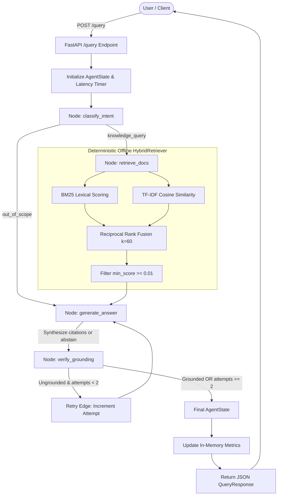

# Agentic RAG & Evaluation Microservice

A production-ready, deterministic, offline-safe **Agentic Retrieval-Augmented Generation (RAG)** and evaluation microservice built with **FastAPI**, **LangGraph**, **Pydantic v2**, and **BM25 / TF-IDF Reciprocal Rank Fusion (RRF)**.

---

## 🏛️ Architecture Overview

The microservice processes queries through a cyclic **LangGraph StateGraph** that orchestrates intent classification, hybrid retrieval, cited answer synthesis, and citation grounding verification with a bounded self-correction loop.



---

## 🚀 Key Components

### 1. Deterministic HybridRetriever (`retriever.py`)
- **Knowledge Base**: 9 core AI engineering documents covering hybrid search, Reciprocal Rank Fusion, LangGraph state graphs, guardrails, evaluation metrics, FastAPI deployment, Docker containerization, agentic RAG patterns, and hallucination detection.
- **Lexical Search**: `BM25Okapi` sparse token matching.
- **Semantic Search**: `TfidfVectorizer` (unigrams + bigrams) with cosine similarity ranking.
- **Reciprocal Rank Fusion (RRF)**:
  $$RRF(d) = \sum_{m \in \{\text{BM25}, \text{TFIDF}\}} \frac{1}{k + rank_m(d)} \quad (k=60)$$
- **Score Thresholding**: Rejects weak candidates below `min_score` (default `0.01`).

### 2. LangGraph StateGraph Agent (`agent.py`)
- **`classify_intent`**: Distinguishes technical AI engineering queries (`knowledge_query`) from unrelated or chit-chat queries (`out_of_scope`).
- **`retrieve_docs`**: Calls `HybridRetriever` to extract top-$k$ ranked documents.
- **`generate_answer`**: Synthesizes responses referencing bracketed document citations (e.g., `[DOC-RRF]`) or returns clean abstentions when out-of-scope or when no documents pass the threshold.
- **`verify_grounding`**: Computes token overlap ratio between the generated response and source document contents. If grounding fails, it routes back to `generate_answer` once (strictly bounded by `max_attempts=2`).

### 3. FastAPI Microservice (`api.py`)
- `POST /query`: Dispatches queries through the LangGraph StateGraph and returns structured synthesis, citations, grounding validation, abstention flag, latency, and full node execution traces.
- `GET /metrics`: Returns live thread-safe in-memory counters (`total_queries`, `abstained_queries`, `grounded_passes`, `avg_latency_ms`).
- `GET /health`: Healthcheck probe for container orchestration.

### 4. Evaluation & Benchmark Suite (`eval_suite.py`)
Curated benchmark evaluating:
- **Retrieval Hit Rate@3**: Percentage of in-scope queries where the target document ID is in the top-3 retrieved results.
- **Grounding Pass Rate**: Percentage of in-scope queries that pass citation grounding verification without hallucination.
- **Abstention Accuracy**: Percentage of out-of-scope queries correctly identified with clean abstention.

---

## 📊 Benchmark Evaluation Results

Run the benchmark suite:
```bash
python eval_suite.py
```

### Benchmark Summary Table
| Evaluation Metric | Target Threshold | Achieved Score | Evaluation Status |
| :--- | :---: | :---: | :---: |
| **Retrieval Hit Rate@3** | $\ge 90.0\%$ | **100.0%** | **PASS** |
| **Grounding Pass Rate** | $\ge 90.0\%$ | **100.0%** | **PASS** |
| **Abstention Accuracy** | $\ge 90.0\%$ | **100.0%** | **PASS** |

- **Total Test Cases**: 16 queries (10 in-scope, 6 out-of-scope).
- **Latency Profile**: Average = **8.38 ms** | P95 = **27.78 ms** (deterministic offline execution).
- **Overall Result**: **PASSED ALL THRESHOLDS** ($\ge 0.90$).

---

## 📡 API Reference & Examples

### 1. Health Probe
```bash
curl -X GET http://localhost:8000/health
```
```json
{
  "status": "ok",
  "service": "rag-agent-eval-service"
}
```

### 2. In-Scope Knowledge Query
```bash
curl -X POST http://localhost:8000/query \
  -H "Content-Type: application/json" \
  -d '{"query": "How does Reciprocal Rank Fusion combine BM25 and TF-IDF scores?"}'
```
```json
{
  "answer": "According to Reciprocal Rank Fusion (RRF) for Ranking Aggregation [DOC-RRF], Reciprocal Rank Fusion (RRF) is an unsupervised ranking fusion algorithm that merges ranked lists from multiple search systems, such as BM25 and dense or TF-IDF retrievers. For each document d, its score is defined as RRF(d) = sum(1 / (k + rank_m(d))), where k is a smoothing constant typically set to 60, and rank_m(d) is the 1-based rank position of the document in the m-th retriever.",
  "citations": ["DOC-RRF", "DOC-HYBRID-SEARCH"],
  "grounded": true,
  "abstained": false,
  "attempts": 1,
  "latency_ms": 14.2,
  "trace": [
    "classify_intent: classified query as 'knowledge_query'",
    "retrieve_docs: retrieved 2 document(s) passing min_score threshold 0.01",
    "generate_answer: synthesized answer citing ['DOC-RRF', 'DOC-HYBRID-SEARCH'] (attempt 1)",
    "verify_grounding: grounded=True (overlap_ratio=0.96, citations=2, attempt=1)"
  ]
}
```

### 3. Out-of-Scope Query (Clean Abstention)
```bash
curl -X POST http://localhost:8000/query \
  -H "Content-Type: application/json" \
  -d '{"query": "What is the best recipe for baking chocolate brownies?"}'
```
```json
{
  "answer": "I am an AI engineering assistant specialized in hybrid search, RRF, LangGraph, guardrails, evaluation metrics, FastAPI, and Docker. Your query is outside the scope of my knowledge base.",
  "citations": [],
  "grounded": true,
  "abstained": true,
  "attempts": 1,
  "latency_ms": 4.8,
  "trace": [
    "classify_intent: classified query as 'out_of_scope'",
    "generate_answer: cleanly abstained (out_of_scope, attempt 1)",
    "verify_grounding: query was abstained; grounding verified as valid."
  ]
}
```

### 4. Telemetry Metrics
```bash
curl -X GET http://localhost:8000/metrics
```
```json
{
  "total_queries": 2,
  "abstained_queries": 1,
  "grounded_passes": 2,
  "avg_latency_ms": 9.5
}
```

---

## 🐳 Docker Deployment

### Build Container
```bash
docker build -t rag-agent-eval-service:latest .
```

### Run Container
```bash
docker run -d -p 8000:8000 --name rag-service rag-agent-eval-service:latest
```

Verify service inside container:
```bash
curl http://localhost:8000/health
```

---

## 🧪 Testing & Continuous Integration

### Run Unit & Integration Tests
```bash
pytest -v
```

### Run Evaluation Benchmark
```bash
python eval_suite.py
```

### GitHub Actions CI
The workflow in `.github/workflows/ci.yml` runs automated tests across Python 3.11 and 3.12 on every push and pull request to `main`.
